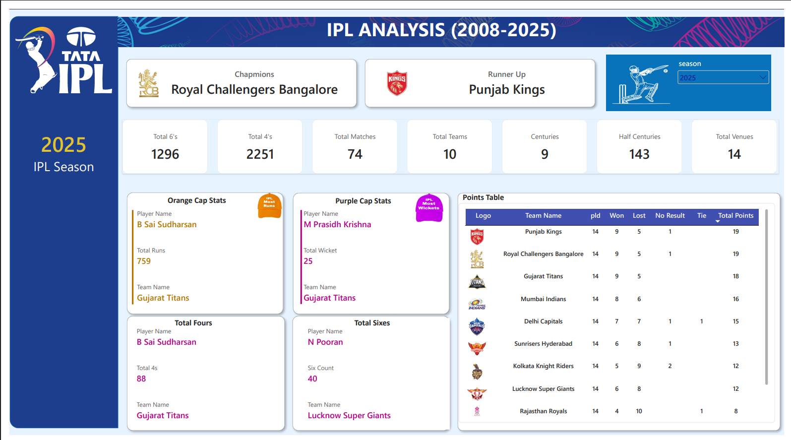

# 🏏 IPL Cricket Analytics Dashboard

## 📊 Project Overview
This project presents an interactive IPL Cricket Analytics Dashboard developed using Microsoft Power BI.

The dashboard helps users explore cricket statistics through interactive visualizations.

## 🖥️ Dashboard Preview

  

## 🛠️ Tools Used
- Microsoft Power BI
- Power BI Data Modeling
- GitHub

## 📁 Project Files
- `IPL.pbix` — Power BI dashboard file
- `Screenshots/` — Dashboard screenshots

## 🎯 Project Objective
To present IPL cricket data through clear and interactive visualizations.
